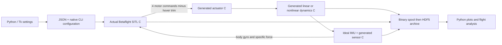

# Native desktop flight simulation

This application runs C generated from the existing Simulink actuator, dynamics,
and sensor blocks together with the actual pinned Betaflight SITL firmware.
The desktop interface uses Python and Tk. Neither MATLAB nor a web service is
called during a native simulation. Work is isolated on `codex/desktop-sil`.

The original `lin_hover_sim.slx`, `lin_hover.m`, MATLAB workbench, and existing
Betaflight host executable are unchanged by this desktop implementation.

The illustrated [PowerPoint walkthrough](docs/Desktop_SIL_Walkthrough.pptx)
covers opening the app, configuring runs, plotting, signal definitions, C
generation, verification, plant updates and future packaging.

## Open and run

Double-click **Open Desktop SIL.cmd** in this directory. The environment and
native executable are already built on this computer. Alternatively, run
`powershell -ExecutionPolicy Bypass -File DesktopSIL/launch.ps1` from the repository.

1. On **Settings → Run setup**, choose Noisy trimmed hover, Noisy roll recovery,
   Angle pulses, or Rate doublets. Each example supplies a complete configuration.
2. Set duration, fidelity, throttle, logging rate, noise/seed, drag and command
   mode on that page. Noise is also available in the top toolbar. Defaults use
   5 Hz gyro and accelerometer low-pass filters, with noise and drag enabled.
3. Use **PID / angle control** for P/I/D/F, angle P and profile selection.
   **Gyro / accelerometer** separates simulated sensor properties from native
   firmware filters. **Initial state / references** uses degrees and degrees/s.
4. Press **Run simulation**. Calibration, arming and throttle settling happen
   before release at flight time zero. Pause/Stop are available during a run;
   Stop also cancels startup. Real-time pacing applies to flight, not calibration.
5. Review **Default plots**, **Explore signals**, and **Flight analysis**. Every
   completed or partially completed flight is archived automatically.

Settings apply to the **next run**. The desktop does not yet change plant or
firmware parameters during an active flight. No rebuild is needed for exposed
runtime parameters. Changing block equations or firmware source does require a rebuild.

The examples stabilize attitude with a fixed throttle; they do not hold position
or altitude. The nonlinear plant has no modeled thrust-generated yaw moment.

## Configuration and Betaflight

The 409-entry **Firmware catalog** comes from the pinned executable's CLI schema.
It includes names, scopes, defaults, choices and constraints. The PID, rate and
battery profile selectors share state with the full CLI editor. Native firmware
parses the final configuration before flight; parser errors appear with a path
to the saved configuration log.

**Receiver / modes / mixer** edits native `map`, `rxrange`, `rxfail`, `aux`,
`adjrange`, mixer and feature commands. **Receiver channels** permits custom
16-channel calibration/flight pulses. Automatic pulses follow the configured
receiver mapping and ARM/ANGLE AUX ranges. Custom flight pulses override the
main throttle field. The adapter currently requires four motor outputs and PWM
motor protocol, as the MATLAB adapter does. A catalog setting for hardware that
is not simulated does not create that hardware in the plant.

**Firmware interface** sets receiver frequency, startup times, motor order and
PID/mixer divider (1–16). The firmware gyro scheduler remains 4 kHz; the divider
sets the PID/mixer frequency. Angle/rate schedules use held commands. Constant
references apply before the first scheduled row. Raw receiver mode uses pulse
inputs directly and requires an empty angle/rate schedule.

The receiver throttle default, 1859 µs, is a receiver input. The plant hover trim,
about 1816.1026 pot, is the motor output calculated from thrust calibration.
They differ because Betaflight applies receiver and motor endpoint scaling.
Derived values shows trim, drag coefficients, areas and the linear A/B matrices.

Save/Load settings uses JSON. Existing MATLAB workbench settings files can be
imported. **Use this run's settings** restores the saved configuration associated
with a selected archive. Script defaults resets to values exported from the
original initialization workflow; the supplied noisy examples are the preferred
first cases. Firmware CLI/JSON can be imported/exported independently.

## Plots and stored signals

**Default plots** has a selector for 15 views: truth attitude/rates, position and
altitude, body velocity, estimated attitude/rates, estimation errors, motors,
raw gyro and raw accelerometer, plus the filtered gyro/accel inputs actually
consumed by Mahony. Position/velocity estimates are explicitly
unavailable for the current IMU-only firmware interface. Reserved zero channels
are not displayed as measurements. Disable default plots on Run setup without
disabling logging or custom plots.

**Explore signals** supports name/group filtering, degrees or stored angular
units, and double-click actions: overlay, replace, or create a plot. Load a
different run and overlay its signals for comparison. Each signal retains its
own time grid. Select legend entries and press Clear selected to remove them;
Clear plot removes all traces. New/Close plot manages custom plots.

All plot windows support mouse-wheel time zoom, drag pan, full-duration reset,
undocking and PNG/PDF export. Undocked windows keep an independent snapshot.
Rendering preserves extrema while limiting points drawn; saved data is not
decimated by the renderer. CSV/MAT exports retain every logged sample at the
selected logging rate. Logging below the base rate is downsampling without an
anti-alias filter; use 16000 Hz for the full default base grid.

**Flight analysis** uses the selected run's saved settings, not unsaved inputs.
Choose Roll/Pitch/Yaw. Seven explained panels cover tracking, feedback,
attitude-estimation error, P/I/D/F contributions, all motor outputs with hover
trim, raw-minus-ideal gyro sensor error, and True-minus-Estimated rate error. RMS includes the entire run and weights
samples by time. Export all panels or undock them.

CSV exports one file per selected signal. MATLAB export writes a `.mat` file
and matching `.m` helper. Run that helper to obtain `hoverSignals` (a structure
of `timeseries`) and `hoverRun` (saved settings/metadata). **Open signals in
MATLAB** exports these files and opens a MATLAB desktop. It is optional and
separate from the simulation engine. Existing workbench `run.mat` archives
(including MATLAB v7.3) can be opened directly.

## Architecture and units



The compiled executable calls the existing firmware host step function directly.
It retains native scheduling, gyro calibration, sensor filters, attitude
estimation, receiver shaping, PID, arming and mixing. There is no replacement
Python PID or estimator, and no per-cycle TCP/Java/MATLAB bridge.

Plant state order is `[x y z u v w phi theta psi p q r]`. Body axes are forward,
right, down; inertial coordinates are NED. UI angular inputs are degrees or
degrees/s; the adapter converts them to radians/radians/s. Native log values use
SI. Plot labels explicitly distinguish degrees from stored radians.

Firmware inputs are noisy body rates and accelerometer **specific force** from
the generated sensor blocks. The existing host converts these to virtual ADC
counts, including the FRD accelerometer sign convention. Truth attitude is not
injected into the estimator as its measurement. Firmware attitude telemetry is
discrete/quantized; smooth plant truth and stepped estimates are distinct signals.

The generated ODE5 (fifth-order Dormand–Prince) solver advances with a default
maximum step of 1/16000 s. Run setup permits 16000, 32000 or 64000 Hz integration
without changing the sensor/controller rates. This is an event-aligned fixed-step
method, not adaptive error-controlled ODE45. Default
physical sensors sample at 3200 Hz (gyro) and 1600 Hz (accelerometer); their
outputs are delivered at 4000 Hz. Native PID/mixer runs at 4000/divider Hz.
Receiver frames default to 100 Hz. The adapter lands on independent sensor,
controller and logging events when runtime rates are changed.

Noise mask power is density² × bandwidth, with **no division by sample rate**,
matching the requested MATLAB configuration. Simulink's band-limited white-noise
block therefore produces variance power/sample-period. Gyro density is converted
from degrees/s to radians/s, and accelerometer density from g to m/s². During
startup, the existing stationary-fixture scheme is reproduced with a deterministic
Box–Muller gyro-noise generator. Its random normal transformation differs from
MATLAB's startup fixture; free-flight noise uses the generated Simulink RNG.
Consequently, whole noisy flights are not claimed to be bit-for-bit identical to
MATLAB startup plus flight. Sensor resolution fields are metadata; the SITL's
virtual ADC quantization is fixed.

## How C was generated

`matlab/buildPlantCode.m` loads the original model and copies the actuator,
dynamics, ideal IMU, gyro, accelerometer, sampling and noise blocks into two new
models under `model/`. It selects the original linear or nonlinear variant,
exposes motor-delta input and six output groups, and removes scopes from the
copies. The original model is not saved or edited.

Configuration: MATLAB R2025b Update 3, ERT (`ert.tlc`), C, continuous-time support,
fixed-step ODE5, single tasking, tunable parameters, separate output/update entry
points, nonreusable functions, and code-only generation. Explicit tunable noise
power variables prevent mask-expression folding from freezing noise density.
Unique utility prefixes allow both independently generated models to link together.

Simulink Coder and Embedded Coder were already installed/licensed; no MATLAB
product download was required. GCC compiles the generated source, adapter and
pinned Betaflight firmware. The generated solver is used directly. Runtime A/B
matrices mirror `hover.buildVariables`; the adapter loads physical parameters,
initial conditions and schedules without regenerating the model.

Generated files retain the Academic License headers emitted by this MATLAB
installation. Betaflight source and its license remain in `Betaflight/upstream`.

## Important files

Paths below are relative to the repository root.

| Path | Role |
| --- | --- |
| `DesktopSIL/Open Desktop SIL.cmd` | Double-click launcher |
| `DesktopSIL/app.py`, `parity_ui.py` | Main Tk desktop interface and configuration/analysis pages |
| `DesktopSIL/configuration.py` | MATLAB preset import, CLI scopes, receiver layout and derived plant values |
| `DesktopSIL/runner.py` | Per-run configuration, native process and progress management |
| `DesktopSIL/storage.py`, `plots.py`, `analysis.py` | HDF5/MAT/CSV, interactive plots and flight metrics |
| `DesktopSIL/native/desktop_sil.c` | Firmware/plant loop, startup, event timing and logging |
| `DesktopSIL/native/plant_adapter.c` | Generated model selection, parameters and output/update calls |
| `DesktopSIL/matlab/buildPlantCode.m` | Reproducible model extraction and C generation |
| `DesktopSIL/model/hover_plant_sil.slx`, `hover_linear_sil.slx` | Separate models used for generation and verification |
| `DesktopSIL/generated/*_ert_rtw/*.c`, `*.h` | Actual generated C and headers |
| `DesktopSIL/build.ps1` | GCC compilation and direct link into actual firmware |
| `DesktopSIL/build/hover_desktop_sil.exe` | Native executable; Cygwin runtime DLLs are adjacent |
| `DesktopSIL/build/venv/` | Isolated Python dependencies |
| `DesktopSIL/catalog/`, `presets/` | Exported original settings, native CLI schema and examples |
| `DesktopSIL/runs/` | Default results library; configurable in the GUI |
| `DesktopSIL/verification/` | Numerical, firmware and GUI acceptance reports |
| `Betaflight/host/bf_host.c` | Existing firmware/virtual-sensor host implementation |
| `Betaflight/upstream/` | Pinned upstream firmware source |
| `Betaflight/toolchain/cygwin/build/betaflight/` | Ignored firmware build copy |

The firmware pin is `c78d9e7bd24ef60f4324dffde11df26c53d4f29f`.
The generated firmware build copy is temporarily adapted and restored by the
build script; `Betaflight/build/betaflight_simulink.exe` is preserved.

## Rebuild and verify

From the repository root, in MATLAB:

```matlab
addpath(fullfile(pwd,'DesktopSIL','matlab'));
buildPlantCode("high");
buildPlantCode("low");
% Optional: refresh exported defaults/catalog after intentional source changes.
% exportDesktopDefaults; exportParityCatalog;
```

Then in PowerShell:

```powershell
.\DesktopSIL\build.ps1
.\DesktopSIL\setup-python.ps1  # only needed when setting up the Python environment
& .\DesktopSIL\build\venv\Scripts\python.exe DesktopSIL/tests/verify_native.py
& .\DesktopSIL\build\venv\Scripts\python.exe DesktopSIL/tests/verify_ui.py
& .\DesktopSIL\build\venv\Scripts\python.exe DesktopSIL/tests/prepare_plant_probes.py
```

After preparing plant probes, run `verifyRuntimePlants` in MATLAB. The build uses
the repository's existing Cygwin GCC toolchain and firmware build checkout.
MATLAB/Simulink headers are needed to rebuild the generated C, but the finished
executable does not need MATLAB Runtime. `build/` and run data are intentionally
ignored by Git; a fresh checkout must rebuild/install them. For a different
MATLAB installation, pass `-MatlabRoot` to `build.ps1`.

## Archive contents and verification

A run folder contains `settings.json`, `derived.json`, `configuration.cli`,
`configuration.log`, `engine.log`, `engine_summary.json`, `metadata.json`, the
small native configuration/EEPROM files, and `signals.h5`. No model or script copy
is saved. During flight, `signals.bin` is an efficient temporary spool. It is
removed only after the HDF5 archive is closed and installed. The archive records
signal names, units, groups and shared time grids. Metadata identifies the exact
executable SHA256, firmware commit, solver and timing, and settings units.

The November 1, 2026 checks passed seven generated-plant/Simulink comparisons
with asymmetric actuator inputs, both fidelities, noise on/off and retuned
physical/sensor parameters. The largest component-wise absolute difference was
3.1e-14 across all seven cases after regenerating with ODE5.
These are numerical comparisons of different physical outputs, not one common unit.

29,202 identical request packets were replayed through the pre-existing TCP
firmware host. All 40 response values were exactly equal at every exchange.
Expanded GUI acceptance covers repeated runs, profiles, catalog edits, command
sections, all default views, analysis axes/panels, exports and MATLAB archives.

In the ODE5 60-second noisy case, native flight took 3.62 seconds (~16.6× real
time), with 960,001 logged rows and a 239.9 MB HDF5 archive. Including configuration
and compression took 13.13 seconds. This is not a measured speedup against MATLAB.
A separate GUI-driven ODE5 10-second run completed configuration, simulation and
archiving in 2.09 seconds. These are sample timings on this computer, not latency guarantees.
Roll/pitch stayed within 1.46° in the 60-second case; z drifted 3.77 m down because
there is no altitude controller. Recovery from +5° roll/−3° pitch ended near
1.05°/0.98° after 20 seconds with noise enabled.

This is a desktop software simulation, not a hard real-time or hardware-in-loop
target. Deterministic repeatability is verified on this build; no equivalence
claim is made for unmodeled peripherals or every possible firmware configuration.

## Signal definitions and exact estimator taps

| Signal family | Source and meaning |
| --- | --- |
| True attitude/rates | Generated plant state, recorded directly |
| Estimated attitude | `attitude.raw` after the native Mahony quaternion update/Euler conversion; native telemetry is quantized to 0.1 degree |
| Estimated body rates | `gyro.gyroADCf`, the processed gyro used as native rate-controller feedback. Betaflight does not expose a separate Mahony body-rate state |
| Filtered gyro into Mahony | Exact `gx, gy, gz` arguments consumed by `imuMahonyAHRSupdate`, including the additional IMU gyro filtering/downsampling |
| Filtered accel into Mahony | Exact `ax, ay, az` arguments consumed by Mahony, converted from ADC counts back to body-FRD specific force |
| Mahony propagation rates | Internal gyro plus Mahony feedback before quaternion integration. This diagnostic is not an independently estimated body rate and does not replace PID rate feedback |
| Attitude/rate estimation error | **True − Estimated**; attitude differences wrap to ±180 degrees |
| Raw gyro sensor error | **Raw − Ideal** before firmware processing. Separate from estimation error |

The firmware instrumentation only records values; it changes no estimator or
filter equations. It is applied to the ignored native build copy and restored
after compilation. The original firmware host and tracked upstream files remain
unchanged. Taps are held in logs between estimator updates; `mahony_update_count`
and `mahony_update_dt_s` identify updates, and `mahony_accel_accepted` reports
whether accelerometer correction was enabled. Older archives do not contain these
new taps. Their historical `filtered_*` rate-feedback keys are relabeled as
estimated rates on import without changing the stored data.

Postprocessing converts display units, calculates altitude/inertial velocity,
aligns truth to an estimate's time grid where necessary, and calculates errors
and RMS. It does not filter the estimated signals again or infer angular rate
by differentiating quantized attitude.

## Integration error checks

`tests/verify_integrator.py` and `verification/integrator_convergence.json` record:

The ODE3 comparison uses the local archived baseline run. On a fresh clone,
the test reports that comparison as skipped and still verifies the ODE5 signal
definitions and five-minute step-halving cases.

* Same noisy 60-second case, ODE3 versus ODE5: maximum attitude difference
  6.61e-12 degrees and maximum position difference 2.66e-11 m.
* Noisy 300-second hover, ODE5 at 16 versus 32 kHz: maximum attitude difference
  3.18e-11 degrees and maximum position difference 1.02e-9 m.
* Quiet 300-second attitude recovery, the same step halving: maximum attitude
  difference 2.50e-11 degrees and maximum position difference 2.46e-9 m.

These cases do not show significant plant integration drift. They do not rule
out errors for a different plant or configuration. Estimator biases, telemetry
quantization, sensor modeling and open-loop position/altitude behavior must be
distinguished from integration error. The ERT generation route uses a fixed-step
solver; an external adaptive integrator is possible but would require a different
native integration interface. See the [MathWorks solver documentation](https://www.mathworks.com/help/simulink/ug/fixed-step-solvers-in-simulink.html).

## Incorporating changes to the Simulink plant

Edit and validate the original plant in Simulink, then run `buildPlantCode("high")`
and `buildPlantCode("low")`, followed by `DesktopSIL/build.ps1`. The extraction
function copies the source blocks fresh each time. Rerun plant equivalence,
native acceptance and integration convergence tests before replacing a trusted
engine. Restart the desktop app after updating its code/catalog; the next run
starts a fresh native process.

Equation changes within the same blocks and ports are the simplest case. If you
rename blocks, change ports, add parameters or change generated structures, also
update `buildPlantCode.m`, `plant_adapter.c`, `desktop_sil.c`, `configuration.py`
and the corresponding UI fields. The present adapter explicitly knows generated
field names and four motor outputs; it is not yet a general plant plugin loader.
Do not edit generated `.c` files to make a plant change: regeneration replaces them.

For a future modular plant, keep these boundaries separate:

1. Actuator dynamics maps commands to local actuator forces and reaction moments.
2. A geometry/force block rotates each local force into body axes and sums force
   and moment about the center of gravity. For mounting rotation R_i and CG-relative
   location r_i: `F_B = sum(R_i F_i)` and
   `M_B = sum(r_i × (R_i F_i) + R_i M_i)`, plus aerodynamic loads.
3. A shared rigid-body block integrates total body force/moment using mass and
   inertia. Keep gravity conventions explicit and account for gravity exactly once.
   Quaternion attitude is preferable for unrestricted orientation; the current
   source plant uses Euler angles.
4. Separate sensor blocks generate measurements from states and accelerations.
   Sensor mount rotation and lever-arm acceleration can be included independently.

This makes arm lengths, mounting angles and actuator count configuration data.
Use a stable bus/interface for total `[Fx Fy Fz Mx My Mz]`, state and sensor
outputs. Reference models or reusable subsystems can preserve these interfaces.
The control allocator/mixer must also match each geometry: a modular plant alone
does not make the current four-motor Betaflight adapter control arbitrary vehicles.
This is an extension plan, not a modification already made to the plant.

## Standalone desktop packaging

The flight engine is already a native executable. The GUI is currently launched
with Python in an isolated environment; this is convenient while editing and
debugging. It can be bundled with Python, Tk, plotting/data libraries, catalogs,
presets, the native engine and Cygwin DLLs so another user opens one application
without installing Python or MATLAB.

For distribution, prefer a **one-folder application with an installer/shortcut**
first. A single-file package is also possible but extracts dependencies on startup
and is harder to diagnose. Packaging does not accelerate the C flight loop.
Writable run data should live outside the installed application directory.
The repository currently supplies a working launcher, not a tested distribution
installer. See [PyInstaller's packaging modes](https://pyinstaller.org/en/stable/operating-mode.html).
