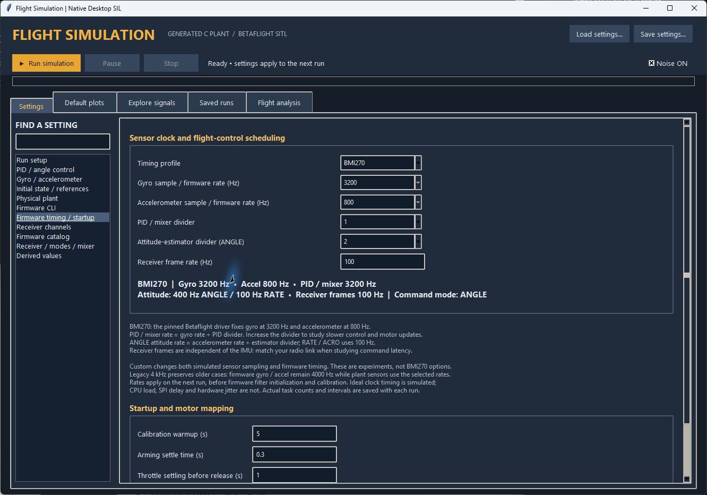

# Firmware timing controls — November 2, 2026

Open **DesktopSIL/Open Desktop SIL.cmd**, then **Settings → Firmware timing / startup**.
The selected rates are also summarized on **Run setup**. Changes apply to the next
run and are saved with its settings. No rebuild is required to change these controls.



## Defaults for the pinned BMI270 driver

| Function | Default | How it is controlled |
| --- | ---: | --- |
| Gyroscope acquisition | 3200 Hz | Fixed by the BMI270 profile |
| Accelerometer acquisition | 800 Hz | Fixed by the BMI270 profile |
| Gyro filtering and rate PID / mixer | 3200 Hz | Gyro rate divided by `pid_process_denom` (default 1) |
| Attitude estimator in ANGLE mode | 400 Hz | Accel rate divided by `imu_process_denom` (default 2) |
| Attitude estimator in RATE / ACRO | 100 Hz | Firmware mode-dependent scheduling |
| Receiver frames | 100 Hz | Independent radio-link setting; not a BMI270 property |
| ODE5 plant integration | 16000 Hz maximum step grid | Run setup; independent of firmware rates |
| Saved data | 4000 Hz | Run setup; independent of integration and control |

These values come from the actual pinned source, commit
`c78d9e7bd24ef60f4324dffde11df26c53d4f29f`, rather than assuming an 8 kHz
gyro or a 4 kHz virtual sensor. Sources:

- [`gyro_sync.c`](../../Betaflight/upstream/src/main/drivers/accgyro/gyro_sync.c):
  BMI270 nominal gyro and accel sample rates.
- [`accgyro_spi_bmi270.c`](../../Betaflight/upstream/src/main/drivers/accgyro/accgyro_spi_bmi270.c):
  actual BMI270 register configuration (normal hardware low-pass mode).
- [`core.c`](../../Betaflight/upstream/src/main/fc/core.c):
  attitude task rescheduling by flight mode, using **accel** sample rate.
- [`gyro_init.c`](../../Betaflight/upstream/src/main/sensors/gyro_init.c):
  PID divider and algorithm loop-time initialization.

The attitude divider is relative to the **accelerometer**, not the gyro, in this
source version. Receiver mode follows the actual AUX-selected flight mode; the
command-mode selector alone does not establish its attitude update rate.

## What to change and why

**BMI270** is the normal timing profile. Its sensor rates are locked because those
are firmware/driver choices on hardware, not arbitrary Configurator sliders.
The PID divider remains adjustable: 1 → 3200 Hz, 2 → 1600 Hz, 4 → 800 Hz.
Increasing it reduces filter/controller/mixer updates and changes latency and
discrete control behavior. It does not slow gyro acquisition. On hardware, CPU
budget or motor protocol constraints can motivate a slower PID loop; this SIL
does not predict CPU utilization.

The **attitude divider** sets 800, 400, about 266.7, or 200 Hz for values 1–4 in
ANGLE. It changes how frequently Mahony processes its filtered inputs. It does
not set the PID rate or the low-pass cutoff. RATE / ACRO uses 100 Hz regardless
of this divider. The default remains 2.

The **receiver frame rate** controls arrivals of new simulated RC packets. Match
the radio mode of interest when investigating command delay, smoothing or
feedforward. Firmware processes packets on its own task schedule, so a packet
arrival and a PID response need not occur at the same instant. The receiver
task is a multi-stage state machine: its task execution count is not a count of
radio packets and can be approximately three times the frame rate.

**Custom** exposes other nominal sensor rates for experiments. Both the plant's
sensor sampling and the virtual firmware sensor initialization use these values.
It does not emulate a different physical IMU's internal filters, range, ADC,
transport, or noise characteristics. An 8 kHz selection is not a claim that the
normal BMI270 driver supports 8 kHz. This profile does not switch hardware LPF modes.

**Legacy 4 kHz** preserves existing cases: firmware gyro and accel tasks use
4000 Hz; simulated plant sensor samples retain the stored, potentially different,
rates. Older settings without a profile and imported MATLAB settings select this
profile automatically. New hover/recovery/angle/rate examples use BMI270.

Sensor filtering remains the requested **5 Hz gyro PT1 and 5 Hz accelerometer PT2**.
PID gains, noise densities/bandwidths, plant equations, ODE5 integration default,
and original Simulink/MATLAB application are unchanged by this timing update.
Changing the accel sample rate from 1600 to 800 Hz does change its sample noise
variance: the retained noise-power formula is density² × bandwidth, so variance
is that power times the sample rate. This is an expected sampling effect, not a
change to the noise-density setting.

## Lower ODE5 integration rates

**Run setup → ODE5 base integration rate (Hz)** offers **3200, 4000, 6400,
8000, 16000, 32000 and 64000 Hz**. The default remains 16000 Hz.
The selected rate sets the base grid; ODE5 also takes shorter steps to reach
every sensor, firmware exchange, receiver and logging timestamp. Controller
rates do not change when you change this setting. The ODE5 order stays the same.

For the default BMI270 timing and 100 Hz receiver:

| Base integration | Logging | Actual ODE5 steps per simulated second |
| ---: | ---: | ---: |
| 3200 Hz | 3200 Hz | 3200 |
| 3200 Hz | 4000 Hz | 6400 |
| 4000 Hz | 4000 Hz | 6400 |
| 6400 Hz | 4000 Hz | 9600 |
| 8000 Hz | 4000 Hz | 9600 |
| 16000 Hz | 4000 Hz | 16000 |

3200 and 6400 Hz are integer multiples of the BMI270's 3200 Hz gyro clock.
For a lower-cost first comparison, use 3200 Hz base integration; retain 4000 Hz
logging if you want the current archive rate, or choose 3200 Hz logging for a
uniform 312.5 µs step. The 4000 Hz option is also available. Its 250 µs base
grid is subdivided by the gyro events, so it does not save steps over the 3200 Hz
option with 4000 Hz logging. The 6400 and 8000 Hz choices take the same number of
steps with these defaults, but their step locations differ.

These counts are **ODE5 steps**, not derivative evaluations: each step evaluates
the continuous plant at several Runge–Kutta stages. They do not include the
firmware scheduler's clock polling. Lowering the plant grid therefore does not
reduce total execution time in direct proportion to the selected rate.

Use **Explore signals → Run details → measured_integration** (also in
`engine_summary.json`) for actual counts, average steps per second, and minimum /
maximum step lengths. Compare against 16000 Hz after changing actuator dynamics,
plant equations or gains. A lower base grid never skips faster sensor or firmware
exchange events; custom 8 kHz firmware still requires those 8 kHz event steps.

The lower-rate acceptance checks compared each new option with 16000 Hz over
60 seconds of noise-free recovery and 60 seconds of noisy hover, using the same
4000 Hz logging and firmware/sensor settings. Maximum attitude differences were
below 1.1e-11 degrees and position differences below 7e-11 m in these cases.
A separate 3200 Hz integration / 3200 Hz logging recovery comparison also passed;
its interpolated attitude difference was below 6.5e-7 degrees. These results
apply to the current plant and gains, not every possible faster or stiffer plant.

The noisy hover engine time fell from 4.79 seconds at 16000 Hz to 4.21 seconds at
3200 Hz base integration (4000 Hz logging) in this check. The speedup is modest
because firmware scheduling and logging work remain. The linear plant with
custom 8 kHz firmware also passed at a 3200 Hz base grid without skipping firmware
updates. Details and saved-run paths are in
`DesktopSIL/verification/lower_integration_rates.json`. Reproduce with:

```powershell
& .\DesktopSIL\build\venv\Scripts\python.exe DesktopSIL/tests/verify_lower_rates.py
```

## What is measured, and what is idealized

The native clock now supports the BMI270's 312.5 µs nominal gyro interval.
Firmware `micros()` timestamps have integer microsecond resolution, so recorded
gyro periods alternate between 312 and 313 µs; their mean is 312.5 µs (3200 Hz).
The upstream algorithm fields still report the upstream truncated integer value
(312 µs at divider 1). That field is not a measurement of dispatch frequency.

Actual upstream task bodies, priority/eligibility rules, PID decimation and
mode-dependent attitude scheduling execute locally. The desktop adapter supplies
an ideal sensor clock, virtual sensor samples, and zero task execution duration.
This matches nominal rates, not the CPU load, jitter, oscillator error, SPI bus
latency or interrupt timing of a specific flight-controller board.

Each run records `engine_summary.json` with actual counts, mean frequency and
last/maximum interval for gyro, filter, PID, accel, attitude and receiver tasks.
The GUI's **Explore signals → Run details** includes this measured timing.
Select the **Firmware task timing** signal group to plot counts, last execution
timestamps, or intervals. Timestamps use the firmware clock (including startup);
the horizontal plot axis is flight time. Counts reset at flight release.
Plot records are sampled at the selected logging rate; counters and the summary
include intervening executions even if the logger is slower than a task.

The source original model, original initialization script, original MATLAB
workbench and original TCP host binary are preserved. `build.ps1` temporarily
patches only the ignored desktop firmware build copy, links the native plant,
then restores those source files. The patch changes sensor initialization,
desktop clock/scheduling adaptation, and passive telemetry; it does not replace
Betaflight's PID, filters, mixer or Mahony equations.

## Reproduce the rate checks

From the repository root:

```powershell
& .\DesktopSIL\build\venv\Scripts\python.exe DesktopSIL/tests/verify_timing.py
```

The test runs BMI270 ANGLE and RATE cases, different PID/estimator dividers,
an 8 kHz custom case, and Legacy timing. Results are written to
`DesktopSIL/verification/timing_acceptance.json`, with paths to the saved runs.

The final November 2 checks passed all five timing configurations. The default
60-second noisy hover measured exactly 3200 Hz gyro/filter/PID, 800 Hz accel,
and 400 Hz attitude estimation, and completed in 4.83 seconds of engine flight
time on this computer (startup and archive time are separate). Maximum absolute
roll/pitch was 1.65°. The 20-second noisy recovery from roll 5° / pitch −3° ended
at approximately 1.26° / 1.17°; this is a noisy attitude-control test with fixed
throttle, not a claim of perfect attitude, position or altitude hold.

Repeated flights produced identical signal arrays. The Legacy profile matched
all 29,202 exchanges (40 response values per exchange) against the original TCP
firmware host. Three consecutive GUI runs, timing-profile edits, plotting,
undocking, exports and startup cancellation passed without callback errors.
