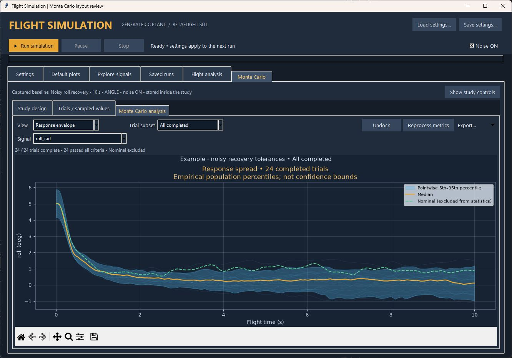
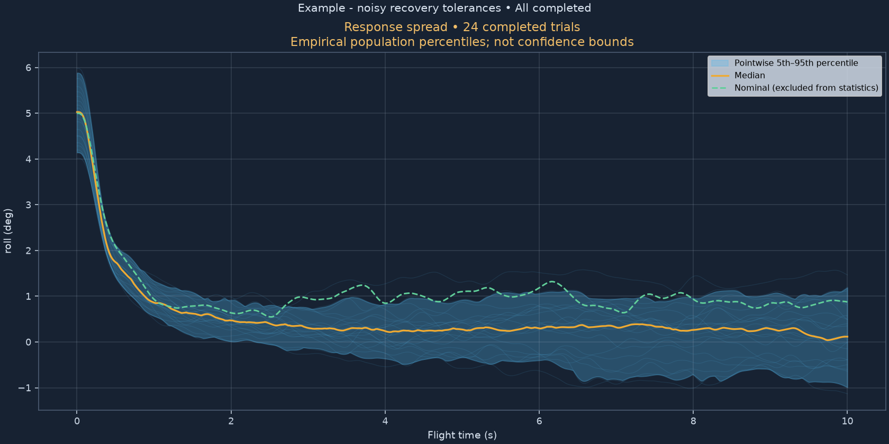
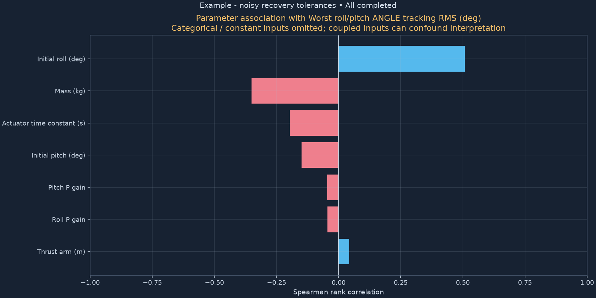
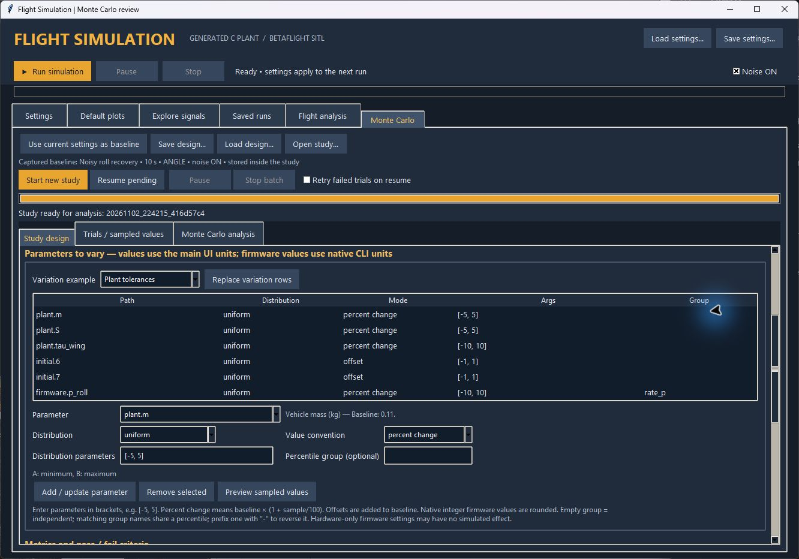

# Monte Carlo studies in the desktop SIL

The **Monte Carlo** tab runs the same local native plant and Betaflight engine
as **Run simulation**. It does not change the model, the firmware algorithms,
or your single-run settings. Studies capture a baseline and vary selected inputs
before each independent simulation. All settings still apply before startup,
calibration and release; parameters do not change during a trial.



## Start a study

1. Open `DesktopSIL/Open Desktop SIL.cmd`. Configure the flight case, duration,
   noise, filters, integration/logging rates, initial conditions and references
   on the ordinary **Settings** pages.
2. Select **Monte Carlo → Use current settings as baseline**. The caption shows
   the captured case, duration, command mode and noise state. Later edits on
   Settings do not change this study unless you capture the baseline again.
3. Set the study name, trial count, design seed and sampling method. Start with
   a small batch while checking your ranges. The default is 24 sampled trials
   plus a separate nominal run, with one worker.
4. Choose a **Variation example** and press **Replace variation rows**, or add
   parameters individually. Examples cover plant tolerances, PID gains, initial
   attitude, sensor biases, and noise seeds alone. Replacing rows affects only
   the study design, not the baseline or a running study.
5. Use **Preview sampled values**. Every sampled case is validated; the preview
   shows the first 12 exact rows. Invalid settings are reported without starting
   any simulation. They are not silently clipped or replaced with new samples.
6. Press **Start new study**. Trials run in separate native processes and folders.
   Progress and results appear under **Trials / sampled values**. A single normal
   simulation and a Monte Carlo operation cannot start on top of one another.
7. Inspect **Monte Carlo analysis**. Double-click a trial, or use **Open selected
   trial in Explore**, to access its full signals in the existing plotting tools.

The supplied initial design varies mass ±5%, thrust arm ±5%, and actuator time
constant ±10%. Those ranges are examples, not measured uncertainties for your
airframe. Choose distributions and bounds from your measurements or test goals.

For a ready-to-run example, choose **Load design…** and open
`DesktopSIL/presets/monte_carlo_recovery.json`. It runs a 10-second noisy recovery
with 24 sampled trials plus nominal, two workers, and variations in mass, arm
length, actuator response, initial roll/pitch, and roll/pitch P gains. A completed
copy is identified in `verification/monte_carlo_example.json`. All 24 sampled
trials completed and met that example's peak-tilt and estimation-error limits.





## Choosing parameters and distributions

The parameter editor shows the selected input's baseline value and constraints.
Use the table scrollbar when the design has more rows than fit on screen.



Type a parameter name fragment into the parameter box, then use its dropdown
arrow to choose an exact path. The adjacent label shows the baseline value and
available constraints. Examples:

| Parameter path | Meaning and input units |
| --- | --- |
| `plant.m` | Mass, kg |
| `plant.S` | Thrust moment arm, m |
| `plant.tau_wing` | Actuator time constant, s |
| `plant.tensor.0.0` | Roll principal inertia, kg m² |
| `plant.CDx`, `plant.CDy`, `plant.CDz`, `plant.CDw` | Drag coefficients |
| `initial.6`, `initial.7` | Initial roll and pitch, degrees |
| `reference.6`, `reference.7` | Constant roll and pitch angle reference, degrees |
| `gyro.bias.0` | X gyro bias, deg/s |
| `accel.bias.0` | X accelerometer bias, g |
| `gyro.density`, `accel.density` | Noise densities, using the main UI units |
| `firmware.p_roll`, `firmware.i_pitch` | Native Betaflight integer menu gains |
| `firmware.angle_p_gain` | Native angle P menu gain |
| `firmware.imu_dcm_kp` | Native CLI gain; physical Kp multiplied by 10000 |
| `firmware.gyro_lpf1_static_hz` | Native gyro cutoff, Hz |
| `plant_hz`, `log_hz`, `rc_hz` | Integration base grid, logging, receiver rates |
| `fidelity`, `command_mode`, `noise`, `drag` | Categorical / Boolean settings |

All angular initial conditions and reference inputs use degrees or degrees/s,
as in the main UI. The catalog includes numeric plant/sensor inputs, initial
states, reference/schedule entries, and native integer/choice firmware fields.
Off-diagonal inertia and sensor-resolution metadata are excluded because the
current plant does not use them. Some firmware settings describe hardware not
present in SIL; exposing a firmware parameter does not create that hardware.

| Distribution | Parameters entered in the bracketed field |
| --- | --- |
| Uniform | `[minimum, maximum]` |
| Normal | `[mean, standard_deviation]` |
| Truncated normal | `[mean, standard_deviation, minimum, maximum]` |
| Log uniform | `[positive_minimum, positive_maximum]` |
| Triangular | `[minimum, most_likely, maximum]` |
| Choices | `[value1, value2, ...]`; each list entry is equally likely |
| Fixed | `[value]` |

**Absolute** uses the sampled value directly. **Offset** adds the sampled value
to the captured baseline. **Percent change** applies
`baseline × (1 + sampled_percent/100)`. For example, uniform `[-10, 10]` in
percent-change mode gives ±10% variation. Zero-valued baselines need absolute
values or offsets. Firmware integer values are rounded to the nearest integer
(ties to even); the actual rounded values are saved in `samples.csv`. Rounding
can make multiple trials share the same menu value.

Use Choices for discrete settings, for example `[3200, 4000, 6400, 8000]` for
`plant_hz`, `[1, 2, 4]` for `firmware.pid_process_denom`, or
`["PT1", "PT2"]` for a supported firmware filter choice. Boolean choices can be
`[true, false]`. Sensor sample rates require a **Custom** timing baseline; BMI270
rates remain locked. Invalid sampled combinations are rejected before launch.
The normal distribution is unbounded; use a physically appropriate truncated
normal or positive log-uniform distribution when necessary.

The baseline area parameterization remains fixed. With wing factors, vary
`plant.AxFactor` rather than the ignored direct `plant.Ax` alias. With direct
areas, vary the area itself. Derived trim and drag values are recomputed for
each trial, while receiver throttle retains its configured/sampled value.

## Sampling, coupled inputs and noise

**Random** uses independent uniform draws before transforming each distribution.
**Latin hypercube** stratifies each independent input percentile across the
requested sample count. Both are reproducible for the saved design seed.
The implementation uses NumPy generators and SciPy's
[LatinHypercube](https://docs.scipy.org/doc/scipy/reference/generated/scipy.stats.qmc.LatinHypercube.html)
and distribution inverse CDFs, including
[truncated normal](https://docs.scipy.org/doc/scipy/reference/generated/scipy.stats.truncnorm.html).
The saved exact samples make resume independent of later library changes.

Leave **Percentile group** empty for independent inputs. Two variables with the
same group name use the same sampled percentile. Prefix a group's name with `-`
on one variable to reverse its percentile. This models fully coupled or reversed
rank variations, such as a shared gain scale. It is not an arbitrary covariance
matrix or a user-selected partial correlation coefficient.

**Independent noise seeds** assigns a reproducible, distinct noise seed to every
sampled trial. **Common** retains the baseline noise seed for all trials, useful
for isolating parameter effects. Design sampling and noise-seed generation use
separate random streams: changing this policy does not change parameter samples.
Common seeds do not guarantee identical physical noise histories if sensor rates
or other RNG-consuming settings change. The baseline noise toggle remains in
effect; varying seeds with noise OFF produces no noise variation.

Startup calibration still runs in every trial. Gyro calibration can compensate
sampled gyro bias. When known accelerometer calibration is enabled, each trial
receives calibration offsets for its sampled bias. Disable that baseline option
if you want to study uncompensated accelerometer bias. No noise formulas or filter
defaults were changed by the Monte Carlo framework.

## Batch controls and recovery

Use **1–4 workers**. One minimizes peak memory; additional workers run separate
firmware processes with isolated files. Parallel ordering does not change the
saved samples or noise seeds. Trials run without real-time pacing.

**Pause** prevents queued trials from starting and pauses active flights.
Calibration may finish before the native flight loop can honor pause.
**Stop batch** stops active trials and retains pending ones. Preflight sampling
and metric reprocessing can also be cancelled. Closing the application requests
stop and terminates its owned native processes if they do not finish promptly.

Open the saved `study.json`, then use **Resume pending**. Completed trials are
preserved; interrupted trials use a new attempt folder with the same sampled
values and seed. Check **Retry failed trials on resume** to retry execution or
analysis failures. Criteria failures are completed trials and are not rerun.
Each study has a writer lock to prevent simultaneous execution from two windows.
A stale run lock is recovered after its owning process exits.

Resume checks the native executable SHA256. If the plant/firmware executable
changed, start a new study so results from different engines are not mixed.

## What the analysis shows

**Response envelope:** up to 20 example trajectories, median, and pointwise
5th–95th percentile spread for the selected signal. The nominal trajectory is
separate and excluded from population statistics. These are empirical response
percentiles, **not confidence bounds** on the mean or guarantees of containment.
Select signals before starting a study; the dropdown includes the native signal
catalog. Full raw and processed signals are retained in every run regardless of
which envelope signals are selected.

Envelope caches interpolate onto a bounded common grid (101–2001 points).
This keeps plotting responsive. Curves are not extrapolated beyond a trial's
duration; exported envelopes include the valid-trial count at each time.
Fast peaks between display points can be missed. Scalar metrics use the original
full-resolution logs, and ordinary Explore plots/export retain full data.

**Metric distribution:** histogram and empirical cumulative distribution, with
the nominal result indicated separately. **Parameter response:** scatter plot
of a selected sampled parameter against a metric; colors show criteria outcome.
**Sensitivity:** Spearman rank correlation for varying numeric inputs, requiring
at least three complete trials. This is an association measure, not a causal
effect or a Sobol variance decomposition. Shared inputs and narrow/quantized
output ranges can make it misleading. Categorical and constant inputs are omitted.

**Outcomes / convergence:** pass, criteria fail, execution/analysis failure,
stopped and pending counts, plus running metric mean in trial-ID order. A flat
running mean alone is not proof that a Monte Carlo study has converged.

Choose **All completed**, **Criteria passed**, or **Criteria failed** to inspect
subsets. Execution failures and stopped trials are always reported separately
and excluded from numeric metric distributions and envelopes. Nominal is always
excluded from population statistics. Exports give the contributing count for
each metric, including cases where a metric is unavailable.

## Metric definitions and reprocessing

The analysis start time applies to all metrics. The end is each trial's end.
Startup calibration and spool-up are outside the flight log and are excluded.

| Metric | Definition |
| --- | --- |
| Peak tilt | Maximum `acos(cos(roll) × cos(pitch))`, degrees from vertical |
| Attitude estimation RMS | Larger of roll and pitch RMS errors, True − Estimated, wrapped angles, degrees |
| Peak attitude error | Largest absolute wrapped roll/pitch estimation error, degrees |
| ANGLE tracking RMS | Larger roll/pitch true-minus-requested-angle RMS, degrees; ANGLE only |
| RATE tracking RMS | Larger roll/pitch true-minus-requested-rate RMS, deg/s; RATE or native receiver setpoint |
| Peak body rate | Maximum absolute p, q or r component, deg/s |
| Horizontal / vertical drift | Maximum displacement from flight-release position within the analysis window |
| Final altitude change | Release z minus final z, positive upward |
| Motor rail fraction | Time-weighted fraction with any motor within 1 pot of configured idle/minimum or maximum output |
| Settling time | Time after the final logged roll/pitch command change, or analysis start if later, until both tracking errors remain inside their bands through the end |
| Final roll / pitch | True final Euler angles, degrees |

RMS metrics are time-weighted. Settling also requires the specified minimum final
settled interval; it is unavailable when unsettled and for raw receiver mode.
Peak metrics include the initial state if analysis starts at zero. For recovery
comparisons, RMS/settling or a later analysis window can be more informative than
a peak dominated by the initial tilt.

Edit analysis start, settling bands, or criteria under **Study design**, then
press **Reprocess metrics** on the analysis page. This reads saved full-resolution
runs without rerunning simulations. Old analysis settings are archived. Invalid
windows leave existing metrics intact. Unavailable/unsettled metrics fail a
criterion that requires them; they are not silently treated as passes. Limits
are your experiment requirements, not flight-certification criteria.

Use the Matplotlib toolbar for zoom/pan/reset. **Undock** opens an independent
snapshot with its own toolbar. The analysis page hides study setup controls to
give the chart more room; **Show study controls** reveals them again. Batch and
reprocessing controls appear automatically during those operations. Only selectors
used by the current chart are shown. The **Export…** menu saves plots as PNG/PDF,
tables as CSV/JSON, and the selected envelope as CSV. Click trial-table headings to sort; double-click
to investigate a worst or failed-criteria run in the ordinary Explore tools.

## Study files and implementation

Studies live under `<selected results library>/monte_carlo/<study-id>/`:

- `study.json`: captured baseline, original design, seeds, engine hash and signal selection.
- `samples.csv`: exact sampled values after integer rounding and each trial's noise seed.
- `manifest.json`: trial state, latest attempt, metrics, criteria result, errors and run path.
- `analysis.json`, `analysis_history/`: current and previous postprocessing definitions.
- `summary.json`, `metrics.csv`: aggregate statistics and per-trial results.
- `ensemble.h5`: compressed display-grid curves; the full logs remain below.
- `runs/trial_<id>_attempt_<n>/`: normal settings/data-only run archives, native logs,
  effective configuration and `signals.h5`. Previous attempts are preserved.

Reusable designs are saved outside existing study archives. The framework adds
`monte_carlo.py` (sampling/execution/metrics), `monte_carlo_ui.py` (workspace),
`mc_charts.py` (analysis charts), and `catalog/native_signals.json` (signal keys).
The existing runner, storage format, generated C, Betaflight engine and normal
plotting paths are reused. If new native signal channels are added in a future
plant build, refresh the signal catalog to expose them as envelope choices.

Acceptance checks cover deterministic sampling, distribution bounds, coupled
inputs, integer settings, metric definitions, exact serial/parallel signal
agreement, pause/stop/resume, recorded engine failures, all five chart views,
GUI editing, reprocessing/reload, opening a trial, and returning to single-run
simulation. The original app regression suite also passed. A 24-trial noisy
recovery example is recorded in `verification/monte_carlo_example.json`.

```powershell
& .\DesktopSIL\build\venv\Scripts\python.exe DesktopSIL/tests/verify_monte_carlo.py
& .\DesktopSIL\build\venv\Scripts\python.exe DesktopSIL/tests/verify_monte_carlo_ui.py
& .\DesktopSIL\build\venv\Scripts\python.exe DesktopSIL/tests/verify_ui.py
```
